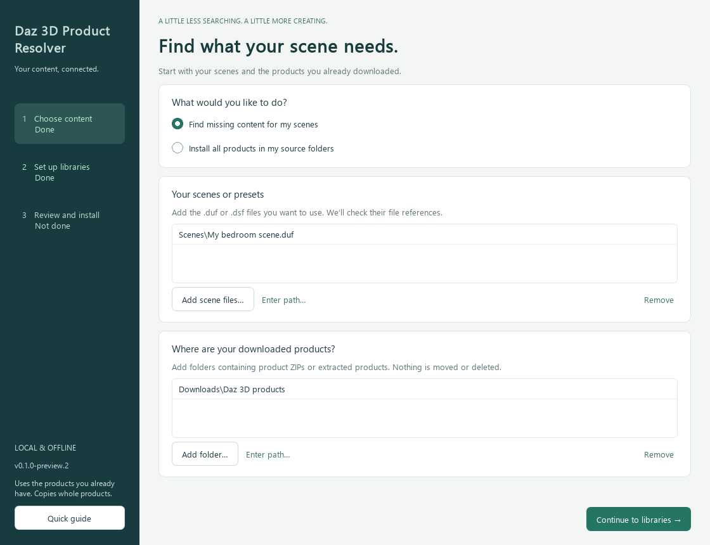
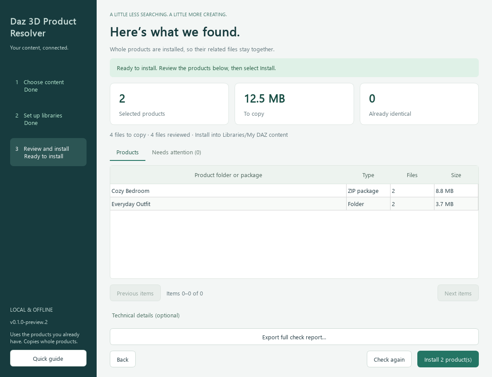

# Getting started

You do not need Python or a terminal to use the Windows app.
Download a Windows preview from [Releases](https://github.com/enaielei/daz-3d-product-resolver/releases).
Choose **windows-x64-setup.exe** for a normal per-user installation, or **windows-x64-portable.zip**
to extract and run without installing. Keep the portable folder's `_internal` directory intact.
Windows 11 x64 is tested; Windows 10 and ARM emulation have not received local desktop acceptance.
Preview builds are unsigned and Windows may display an unknown-publisher warning. No signing
certificate or publisher reputation is claimed. Only use files from this repository's Releases.

## 1. Choose content

Screenshots use synthetic example names, not purchased content or personal paths.

**Find missing content for my scenes** checks .duf/.dsf scenes or presets. Add one or more files
with **Add scene files**, or drag them into the list.

**Install all products** uses every supported product found in your source folders. Choose this
deliberately when you want to install a collection rather than resolve a specific scene.

Add **source folders** containing product ZIPs or extracted downloads. The resolver searches
subfolders. Your originals stay where they are. This tool does not download purchased products.

## 2. Set up libraries

A **source folder** contains downloads you want to install. A **content library** contains files
DAZ Studio can already use, usually with data, People and/or Runtime subfolders. Select the
library root rather than one of those subfolders.

Add already installed libraries so the resolver can find existing dependencies first.
**Find my DAZ folders** reads local DIM/Studio settings. If several profiles or Studio versions
are found, choose the one you want; the tool does not guess which is active. **Add these detected
folders** preserves folders you added manually. Settings are read-only and provenance appears
in optional technical details. Detection does not automatically choose an install destination.

Choose an **installation library** explicitly. If you only want to inspect dependencies, select
**Check only**. Checking does not copy product files. You can choose a destination later and check
again to inspect conflicts there.

## 3. Review and install

The review shows selected product folders/packages, their sizes and file counts. A missing file
selects its **whole containing product**, including related content. Optional unreferenced
presets are copied without automatically pulling all their dependencies.

**Needs attention** explains what is preventing installation:

- Missing file: add another source folder containing that product and check again.
- Multiple matching products: select the desired product in the dropdown and check again.
- Different existing file: choose **Keep my existing file** or **Replace it (back up original)**,
  then check again. A different file is never overwritten by default.
- Ambiguous extracted boundary: open **Advanced: product folder boundaries** and add the
  actual product folder, then check again.
- Unsupported or inconsistent package: the package is skipped; review the reported reason.

The install button remains unavailable until blocking items are resolved and a destination is
chosen. Identical files are skipped. A green “You're all set” message means the static references
checked are already available; no installation is needed.

When ready, click **Install**. Progress and cancellation run in the background. Wait for safe
cancellation before closing. After verification, **Open installation library** shows the result.
If you created a new content library, you may need to map it in DAZ Studio yourself; this app
does not change Studio settings or register products with DIM/Smart Content.

## Safety and limits

Use one installer at a time and keep source/destination trees idle. Replacements are backed up
and transactions are recorded separately from DIM in `.daz-product-resolver` inside the chosen
library. Do not remove backups until you have checked the result. The source products are never
deleted. See [troubleshooting](troubleshooting.md) for interrupted transactions.

This is a static reference resolver. Scripts, dynamic/autoload dependencies and proprietary
encrypted formats are not exhaustively handled. There are bounded file/archive limits.
Technical JSON is optional; you do not need to edit it to use the desktop app.

## Check progress and diagnostics (preview 2)

Checking reports discovery, inventory, shared-payload comparison and library-lookup phases.
Install-all can involve large source sets. **Check only** compares overlapping files and defers
verification of unique payloads until an install library is chosen; it is not an exhaustive integrity
scan of every archive. Actual installation still revalidates full selected product inventories/hashes.

If selected products contain different versions of the same library-relative file, choose which
product supplies that file, or remove an unwanted source collection and check again. No source is
silently preferred. Products remain selected whole; their shared destination path is written once
using the explicit provider choice. Existing-destination keep/replace decisions are separate.

The sidebar shows which steps are done, running or need attention. Long attention lists have
Previous/Next controls. Technical details are a small summary; **Export full check report** saves
all file/provider records without formatting the entire inventory in the window.

Private local diagnostics record operation inputs, phases, elapsed time and bounded result samples.
On Windows they live under `%LOCALAPPDATA%/daz-3d-product-resolver/logs`. Use **Open private
diagnostic logs** to find them. Logs/reports can contain local paths and product names; review/redact
them before sharing. No account fields or product payloads are logged, and nothing is uploaded.
Preview 1 did not persist check-only logs, so its past checks cannot be reconstructed from logs alone.
